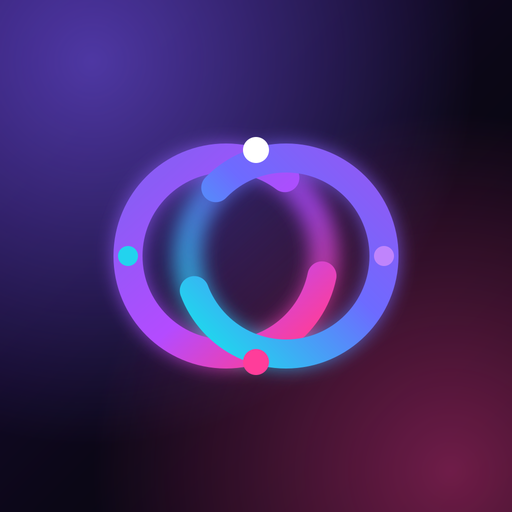
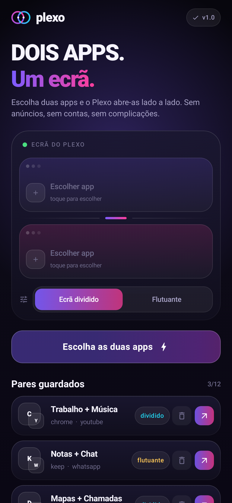
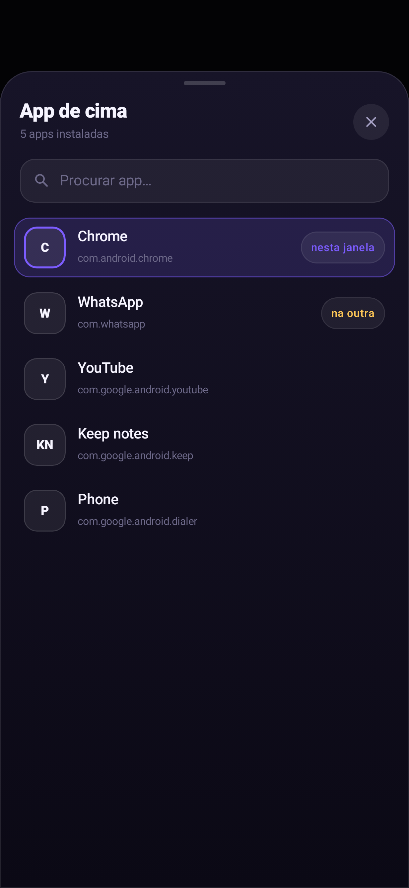
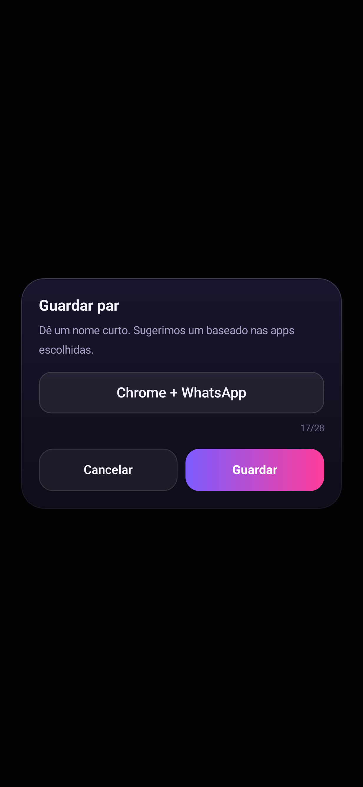

<div align="center">



# Plexo

### Dois apps. Um ecrã.

**Abre duas aplicações em simultâneo, em ecrã dividido, com um único toque.**

[](https://github.com/melven-codezx/plexo/actions/workflows/android.yml)
-3DDC84?logo=android&logoColor=white)


</div>

---

## O que é

O Plexo resolve um problema recorrente: **o Android obriga-te a abrir um app, ir aos recentes,
manter premido e escolher "ecrã dividido"** — todas as vezes. O Plexo transforma isso num gesto:
escolhes duas apps, guardas o par com um nome, e a partir daí é um toque.

| Ecrã principal | Seletor de apps | Guardar par |
|---|---|---|
|  |  |  |

## Funcionalidades

- **Abertura em simultâneo** — dois apps lado a lado com um toque, sem passos intermédios.
- **Pares guardados** — até 12 combinações com nome próprio ("Trabalho + Música").
- **Dois modos** — *Ecrã dividido* (padrão) ou *Flutuante* (janelas redimensionáveis, em dispositivos compatíveis).
- **Widget 2×2** — o último par usado abre diretamente do ecrã inicial.
- **Tile nos ajustes rápidos** — o par mais recente a partir de qualquer ecrã.
- **Sem permissões perigosas** — não pede localização, câmara, contactos ou acessibilidade.
- **Offline e privado** — tudo fica no dispositivo; zero telemetria, zero contas.
- **Acessibilidade e bateria** — respeita "remover animações" do sistema.

## Como funciona (o truque técnico)

O Android não tem API pública para "abrir dois apps em ecrã dividido". O Plexo usa uma
**cascata de três estratégias**, escolhendo a primeira que o dispositivo aceitar:

| # | Estratégia | Mecanismo | Onde funciona |
|---|---|---|---|
| 1 | `PAIR_WINDOWING` | `startActivities([A, B])` com `ActivityOptions` a pedir `WINDOWING_MODE_SPLIT_SCREEN_PRIMARY` + `splitScreenCreateMode=TOP_OR_LEFT` | Android 8+ (maioria dos fabricantes) |
| 2 | `ADJACENT` | `startActivities` com `FLAG_ACTIVITY_LAUNCH_ADJACENT` em ambas as intenções | Android 7+, ecrã já dividido |
| 3 | `SEQUENTIAL` | Abre A e B em sequência (750 ms) e deixa-os prontos nos recentes | Todos, como rede de segurança |

O modo **Flutuante** tenta `ActivityOptions.setLaunchBounds()` para duas janelas livres.

> O teste `EndToEndTest` imprime a estratégia realmente usada em cada build, na CI.

## Compilar

```bash
# Requisitos: JDK 17 + Android SDK 34
./gradlew :app:assembleDebug      # APK de debug
./gradlew :app:assembleRelease    # APK release (R8 + assinatura)
./gradlew :app:testDebugUnitTest  # 14 testes
```

**Assinatura de release** (variáveis de ambiente):

```bash
export RELEASE_KEYSTORE_PATH=/caminho/plexo-release.jks
export RELEASE_KEYSTORE_PASSWORD=...
export RELEASE_KEY_ALIAS=plexo
export RELEASE_KEY_PASSWORD=...
./gradlew :app:assembleRelease
```

Na CI, basta configurar os secrets `KEYSTORE_BASE64`, `KEYSTORE_PASSWORD`, `KEY_ALIAS`
e `KEY_PASSWORD` — o workflow [`.github/workflows/android.yml`](.github/workflows/android.yml)
compila, testa e publica os APKs como artefactos.

## Testes

| Suite | Cobre | Resultado |
|---|---|---|
| `PairCodecTest` | serialização, texto corrompido, nomes | 4 ✅ |
| `SplitLauncherTest` | intenções, extras, fallback amigável | 4 ✅ |
| `EndToEndTest` | motor com activities reais, persistência, widget | 3 ✅ |
| `UiRenderTest` | render Compose + capturas de ecrã (Robolectric) | 3 ✅ |

As capturas em `docs/screenshots/` são **geradas pelos próprios testes**, não são mockups.

## Estrutura

```
app/src/main/java/com/melven/plexo/
├── MainActivity.kt              # entrada Compose + splash
├── PlexoApp.kt                  # catálogo de apps + preferências
├── data/                        # AppEntry, AppCatalog, Pair, PairCodec, PairStore
├── launch/                      # ⚙️ SplitLauncher (as 3 estratégias), LaunchPairActivity
├── tile/PlexoTileService.kt     # tile nos ajustes rápidos
├── widget/                      # widget 2×2 (RemoteViews)
└── ui/                          # tema aurora, componentes, ecrãs, ViewModel
```

## Design

Identidade "aurora": preto tinta `#07060D`, violeta `#7C5CFF`, magenta `#FF3D9A`,
ciano `#22D3EE`. Marca: **dois anéis entrelaçados** — dois apps, um ecrã.
Ícones densos (mdpi→xxxhdpi), ícone adaptativo (inclui *monochrome* para temas do sistema),
widget, tile e splash.

## Limitações honestas

- Alguns fabricantes (Samsung One UI, Xiaomi HyperOS) restringem a divisão a apps declaradas
  como redimensionáveis; nesses casos o Plexo cai para o modo sequencial.
- No Android 12L+ a divisão forçada é mais restrita por desenho do sistema.
- O Plexo não força apps a serem compatíveis com multi-janela — apenas as emparelha.

## Licença

MIT. Feito em Maputo 🇲🇿.
